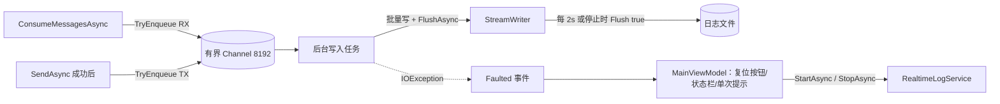

## 产品概述

在现有串口助手中新增「日志实时保存」：接收区标题栏提供一个状态可切换的胶囊按钮，开启后把接收与发送的双向数据持续写入用户指定的文件，停止或关闭程序时保证数据完整落盘。

## 核心功能

- **切换按钮**：位于「数据接收」标题栏右侧，未开启时显示灰点 +「日志保存」，开启后显示绿点 +「停止日志」，悬停提示当前文件路径。
- **路径设置弹窗**：首次点击开启弹出模态窗口，包含完整路径输入框、浏览按钮、确认/取消；默认填入上次路径或「文档」目录下按时间命名的 `.log` 文件。
- **路径校验**：空路径、非法字符、目录不存在、指向文件夹等情况在弹窗内以红色提示就地拦截；确认后若文件无法创建或没有写权限，则在主界面提示并保持关闭状态。
- **实时写入**：开启后接收数据（与 HEX、时间戳开关对应的格式化结果）与发送数据（含 CRC 追加后的实际字节）逐条写入，每条带毫秒时间戳与 RX/TX 标识。
- **暂停独立**：勾选「暂停显示」只停止界面刷新，日志仍持续记录。
- **安全停止**：再次点击停止、程序关闭或写入故障时，先冲刷缓冲并落盘再释放句柄；已存在文件采用追加写入，保留历史内容。
- **异常反馈**：磁盘写满、文件被删除、权限变化等运行期故障只提示一次并自动停止，状态栏显示原因，不弹循环错误框。

## 技术栈

- 沿用 WPF `net10.0-windows`、CommunityToolkit.Mvvm 8.4.2、`System.Threading.Channels`（项目已在用），不新增 NuGet 依赖。
- 文件写入使用 `FileStream` + `StreamWriter`（UTF-8 无 BOM），后台任务消费有界 Channel。

## 实现思路

采用「单次会话写入服务 + ViewModel 编排 + 自定义路径弹窗 + 标题栏切换按钮」四层结构：

1. `RealtimeLogService` 每次开启创建一个实例（单次会话、不可重启），构造时创建容量 8192 的有界 Channel；`StartAsync` 先校验路径并打开文件（`FileMode.Append`、`FileShare.Read`、64KB 缓冲），写入会话头后启动后台写入任务；`StopAsync` 关闭 Channel、排空队列、`Flush(true)` 落盘并释放。
2. 后台任务按批取出（单批上限约 256KB 或 200ms），批量写入后 `FlushAsync` 交给系统缓冲；累计写入超过 2 秒或 1MB 时执行一次 `FileStream.Flush(true)` 刷盘，兼顾实时性与磁盘寿命。
3. 接收侧在 `ConsumeMessagesAsync` 中重构顺序：先格式化 payload，再写日志，最后判断是否暂停/入显示队列。仅在「暂停且日志关闭」时保留原有零解码快速丢弃路径；暂停且日志开启时照常解码与记录，只跳过 `_displayQueue`。
4. 发送侧在 `WriteAsync` 成功返回后入队，payload 为 `IsSendHex ? FormatHex(data) : UTF8(data)`，其中 `data` 已包含 CRC。
5. 界面按钮使用 `Button` + `IsLogSaving` 数据触发器（而非双向 `ToggleButton`，避免点击瞬间状态与真实写入状态错位）；命令使用 `AsyncRelayCommand`，默认禁止并发执行。
6. 运行期故障由服务捕获并通过 `Faulted` 事件上报，服务原子地转为关闭态；ViewModel 在 UI 线程复位按钮、显示状态栏并只弹一次提示。

## 关键决策与权衡

- **不用 `File.AppendAllText` 逐包写**：每包开闭句柄、无法批量、易与编辑器占用冲突；现有 `CrashLogger` 仅适合低频崩溃记录，保持其职责不变，不复用为数据日志。
- **批量 + 定时 fsync**：每包 fsync 会造成严重 I/O 抖动；200ms 内可见、2 秒刷盘可把异常断电的丢失窗口限制在 2 秒内，正常停止零丢失。
- **单次会话实例**：避免 Channel 复用、重启竞态和半关闭状态机；停止后置空引用，接收线程通过 `volatile` 读取，`TryEnqueue` 在已关闭时直接返回。
- **先格式化再判断暂停**：满足「暂停仍记录」，同时保留日志关闭时的零开销丢弃，避免无谓解码。
- **弹窗只做格式校验，服务做真实可写性校验**：防止 TOCTOU，同时让「无法创建文件」有统一错误出口。

## 性能与可靠性

- 入队为 O(1)，写入为 O(n) 批量；文件 I/O 全部在后台线程，UI 与串口接收线程零阻塞。
- 队列满时 `TryWrite` 失败并计数，不阻塞、不无界占用内存；停止时若存在丢弃，状态栏附带「队列溢出丢弃 N 条」。
- 日志开启后每条 RX 仅多一次字符串入队，格式化成本原本已存在；暂停且日志关闭时行为与现状一致。

## 架构设计



## 目录结构

```
SerialAssistant/
├── Model/
│   └── LogDirection.cs            # [NEW] RX/TX 方向枚举，与 SerialConnectionState 同目录保持约定
├── Services/
│   └── RealtimeLogService.cs      # [NEW] 单次会话日志写入器。实现 StartAsync/StopAsync/TryEnqueue/Faulted，
│                                  #       有界 Channel、后台批量写入、定时 Flush(true)、丢弃计数、异常自停与幂等释放。
│                                  #       StartAsync 负责 Path.GetFullPath、目录存在、追加打开、写会话头。
├── View/
│   ├── LogPathDialog.xaml         # [NEW] 路径设置弹窗。标题+说明、路径输入框、浏览按钮、内联红色错误提示、
│   │                              #       取消/确认按钮；复用 Card/GhostButton/FieldLabel 等现有资源。
│   ├── LogPathDialog.xaml.cs      # [NEW] 浏览（SaveFileDialog，OverwritePrompt=false）、
│   │                              #       TryResolvePath 校验（空值/引号/非法字符/目录存在/非目录/补 .log）、
│   │                              #       确认后暴露 FilePath 并 DialogResult=true；Esc 取消。
│   └── MainWindow.xaml            # [MODIFY] 接收区标题栏右侧新增日志切换按钮（圆点+文字，ToolTip 绑定路径），
│                                  #          放在「清空」之后；绑定 ToggleLogSavingCommand / IsLogSaving / LogButtonText。
├── ViewModel/
│   └── MainViewModel.cs           # [MODIFY] 注入可替换的路径选择委托（默认弹 LogPathDialog）；
│                                  #          新增 IsLogSaving/LogFilePath/LogButtonText 与 ToggleLogSavingCommand；
│                                  #          接收侧重构格式化→写日志→暂停判断；发送成功后写 TX；
│                                  #          订阅 Faulted，停止/故障/Dispose 时落盘并复位状态。
└── style/
    └── CommonStyle.xaml           # [MODIFY] 新增 SuccessSoft 浅绿背景与 LogToggleButton 样式
                                   #          （未开启白底灰字、开启浅绿底绿字绿点），供按钮与弹窗复用。
```

## 关键结构

```
public enum LogDirection { Rx, Tx }

public sealed class RealtimeLogService : IAsyncDisposable
{
    public bool IsEnabled { get; }
    public long DroppedEntries { get; }
    public event EventHandler<Exception>? Faulted;

    // 打开文件并写会话头；路径非法/无权限时抛 ArgumentException、DirectoryNotFoundException、IOException 等
    public Task StartAsync(string filePath, string? sessionInfo, CancellationToken cancellationToken = default);

    // 非阻塞；未开启或队列满时返回，满则计数
    public void TryEnqueue(LogDirection direction, DateTimeOffset timestamp, string payload);

    // 幂等；完成队列、排空、Flush(true)、释放
    public Task StopAsync();
}
```

日志行格式：`[2026-10-28 12:00:00.123] [RX] payload`，payload 不以换行结尾时补一个，保证条目可辨识；会话头为 `# SerialAssistant 实时日志`、开始时间、端口/参数、显示模式。

## 实现要点

- **暂停逻辑**：`if (_paused && log is null) { 计数丢弃; continue; }` → 解码格式化 → `log?.TryEnqueue(Rx, ...)` → `if (_paused) { 计数丢弃; continue; }` → 显示入队。日志 payload 不含显示用时间戳前缀，避免双重时间戳；显示时间戳逻辑与 `lastChar` 维持原样。
- **停止顺序**：`DisposeAsync` 中先取消生命周期并等待接收/显示任务结束，再 `StopAsync` 日志（≤3 秒），最后释放串口，确保 5 秒关窗上限内先完成落盘。
- **竞态**：开启/停止均在 UI 线程；服务内部用 `Interlocked` 控制 `_enabled`，`TryEnqueue` 捕获 `ChannelClosedException`；`Faulted` 处理用 `RunOnUi` 且只提示一次。
- **与 CrashLogger 衔接**：数据日志独立；仅把开启失败、写入故障、停止异常以 `CrashLogger.Log("RealtimeLog.*", ex)` 记录，便于诊断，不把数据流量写入崩溃日志。
- **不改动**：导出、清空接收区、计数、HEX/时间戳逻辑；清空界面不影响已写入文件。日志开启弹窗期间收到的数据不会补录，属预期行为。
- **验证场景**：正常开启/停止、追加已有文件、无扩展名补 `.log`、空/非法/不存在目录、只读文件、写入中删除文件或占满磁盘、暂停时仍记录、开启状态下关窗、重复快速点击、未连接串口时开启。